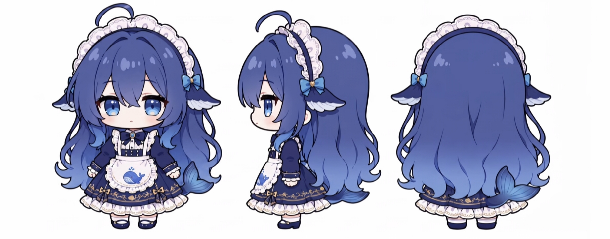

# 蓝鲸女仆 · 篮球舞复刻

用三视图重建蓝鲸女仆，从骨骼绑定、四秒试跳，一直制作到带自我介绍的篮球舞。最终输出可旋转查看角色的单文件网页、带完整动作和表情的 GLB 模型，以及 49.3 秒的 1080p60 有声视频。



[下载完整 Agent 复刻包](blue-whale-maid-agent-kit.zip?raw=true) · [阅读给 Agent 的任务书](给Agent的任务书.md)

## 运行

在新目录解压复刻包，或直接克隆本仓库。在项目根目录使用同一个 Python 环境执行以下命令。本版验证环境为 Windows、Python 3.14、OpenGL 3.3 和支持 libx264 的 FFmpeg，终端应能运行 `ffmpeg -version`。

```sh
python -m pip install -r requirements.txt
python -X utf8 复刻.py
```

动作关键点和对齐好的 FLAC 音轨已随项目提供。脚本会依次生成角色、旋转预览、篮球试跳和完整版，再读取成片核对帧数、音画时长、发束、口型和篮球触地。

## 输出

| 文件位置 | 内容 |
| --- | --- |
| `旋转查看模型.html` | 可单文件分享的静态角色旋转预览 |
| `骨骼动画/篮球尺寸校验/` | 四秒运球与抖肩试片 |
| `骨骼动画/篮球舞_原片复刻/` | 最终动画 GLB 与有声 MP4 |

源码中的轮廓、骨骼位置和面部区域按蓝鲸女仆的三视图标定。换成其他角色时，请按任务书中的说明重新标定。
